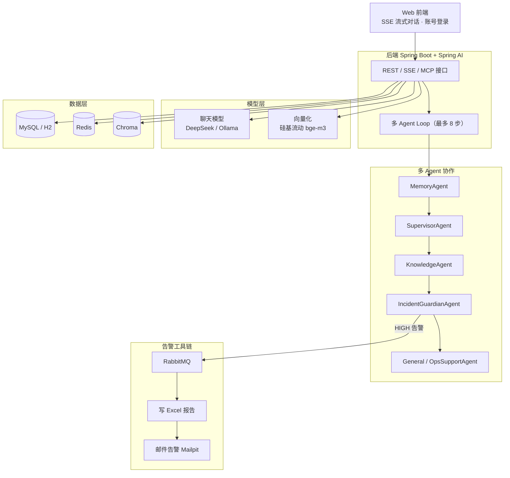
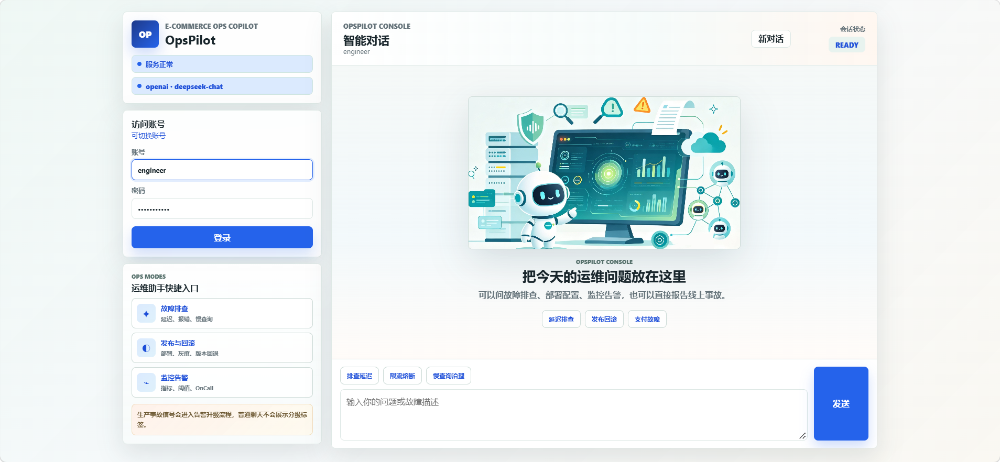
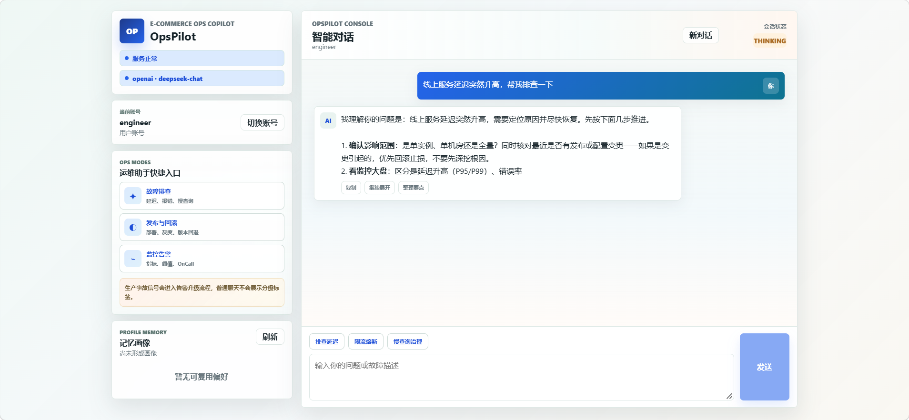
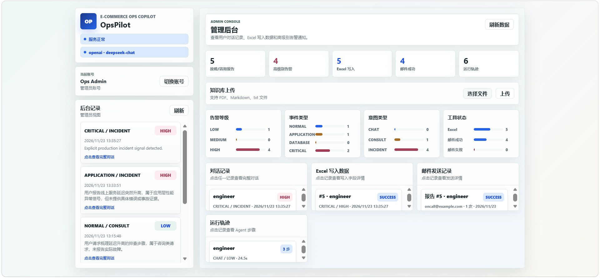
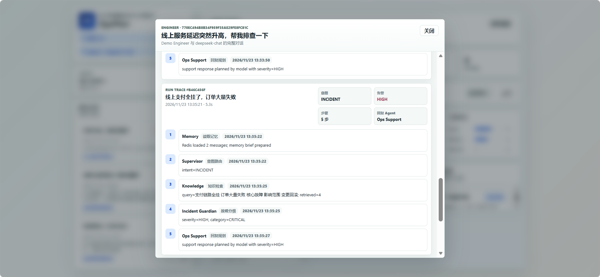
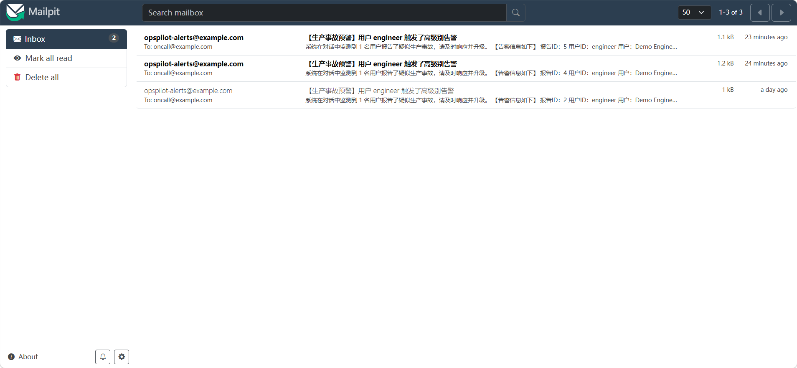
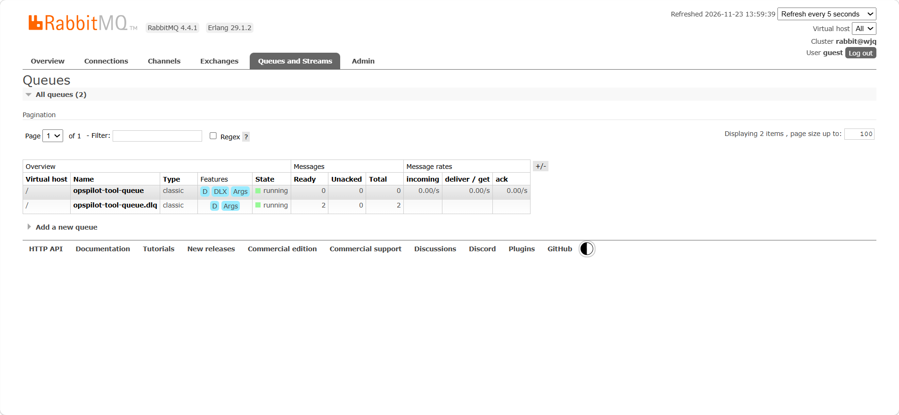
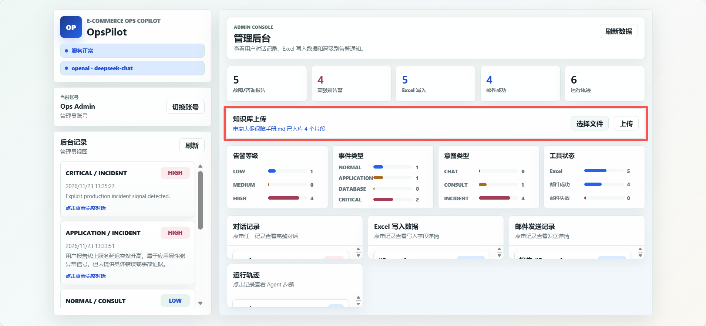
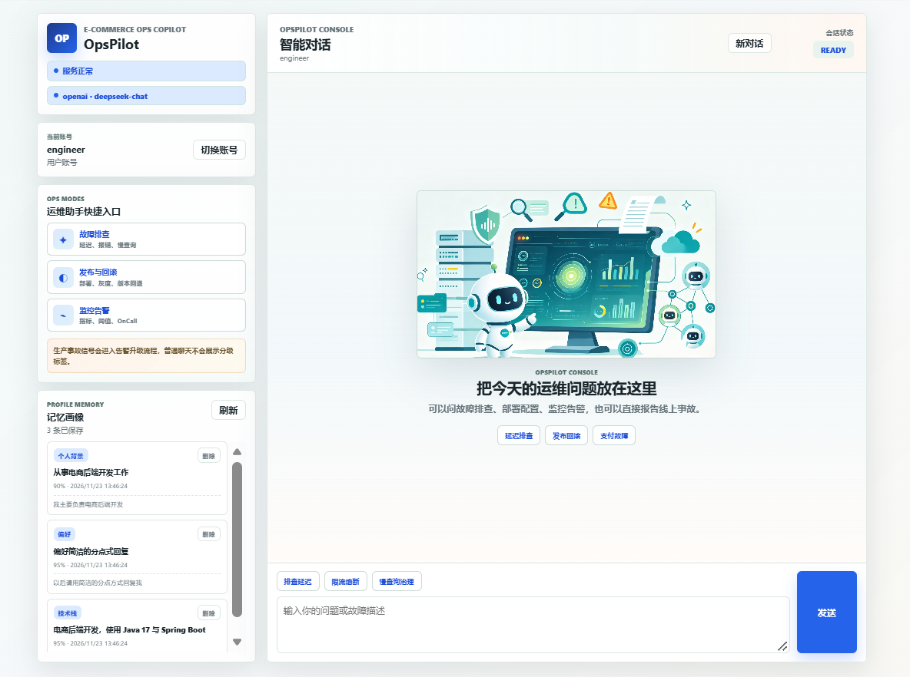

# OpsPilot Agent

OpsPilot 是一个面向电商平台的运维多智能体平台，基于 Spring Boot + Spring AI 构建，把「动态路由 RAG、多 Agent 协作、用户画像记忆、故障分级与告警升级」串成一条完整链路。

- 动态路由 RAG：先识别 `CHAT / CONSULT / INCIDENT`，闲聊不查知识库，运维咨询与生产事故消息才进入检索增强。
- SSE 流式输出：`/api/chat/stream` 返回 `text/event-stream`，适合前端做打字机效果。
- 后台故障分级：记录事件类型、严重度得分、告警等级和置信度，但用户端不展示评估结果。
- 用户画像记忆：从对话中抽取稳定偏好、沟通方式、技术栈和工作习惯，MySQL 保存可审计记录，Chroma 负责语义召回。
- 数据闭环：咨询/事故消息写入数据库，高级别告警先写 Excel，再触发邮件或 HTTP MCP 预警。
- 模型可插拔：聊天走 OpenAI 兼容接口（默认 DeepSeek），向量化走硅基流动 bge-m3，也可切回本地 Ollama。
- 可替换知识库：默认本地轻量检索，可打开 Chroma 镜像和查询。
- 多 Agent loop：每轮输入由 MemoryAgent、SupervisorAgent、KnowledgeAgent、IncidentGuardianAgent、GeneralAgent / OpsSupportAgent 协作完成。

大模型 LoRA 微调、合并、GGUF 转换和 Ollama 接入流程见：[docs/qwen25-7b-lora-finetune-guide.md](docs/qwen25-7b-lora-finetune-guide.md)。

## 系统架构



## 项目截图

### 登录与对话

**登录页** — Basic Auth 双角色登录（`engineer` 普通用户 / `admin` 管理员）



**智能对话（SSE 流式输出）** — 运维咨询走动态路由 RAG，回复打字机式实时输出



### 故障告警链路

**故障告警触发** — “线上支付全挂了” 触发 HIGH 高等级告警，进入后台工具链



**管理后台 · 事故报告列表** — LOW / MEDIUM / HIGH 分级标签 + 指标卡



**运行轨迹 · 多 Agent 分步流转** — Memory → Supervisor → Knowledge → Incident Guardian → Ops Support 每一步的决策过程


**Mailpit 告警邮件** — 高级别告警自动通过 SMTP 发出



**RabbitMQ 工具队列** — 告警任务异步投递与消费



### RAG 与记忆

**知识库上传** — 支持 PDF / Markdown / txt，自动切块入库



**用户画像记忆** — 从对话抽取技术栈、沟通偏好等长期记忆



## 目录

```text
src/main/java/com/opspilot/agent
├── config                 # 配置、安全、AI/MCP Bean
├── controller             # Chat / Knowledge / Report API
├── domain                 # JPA 实体与枚举
├── dto                    # 请求与响应对象
├── repository             # Spring Data JPA
├── security               # 当前用户与认证查询
└── service
	    ├── ai                 # Spring AI 模型适配器与 Prompt
	    ├── agent              # 多 Agent loop：记忆、路由、知识检索、告警守护与回复规划
	    ├── knowledge          # 切块、检索、Chroma 网关
	    ├── memory             # Redis 短期记忆与用户画像长期记忆
	    └── mcp                # Excel 与邮件/HTTP 预警工具
```

## Agent loop 与多 Agent 分工

每轮对话进入一个有限步 agent loop，最多执行 8 步，防止运维场景中出现无限自主循环：

```text
MemoryAgent
-> SupervisorAgent
-> KnowledgeAgent
-> IncidentGuardianAgent
-> GeneralAgent / OpsSupportAgent
```

各 Agent 分工：

- `MemoryAgent`：读取 Redis 短期记忆，并用当前输入从 Chroma 召回相关用户画像；Redis 为空时从 MySQL 长期聊天记录恢复。
- `SupervisorAgent`：调用模型判断 `CHAT / CONSULT / INCIDENT`，决定后续交给普通闲聊还是运维支持链路。
- `KnowledgeAgent`：调用模型改写 Chroma/RAG 检索 query，并判断检索结果是否足够，不足时二次检索。
- `IncidentGuardianAgent`：调用模型做后台故障分级，同时保留事故词库硬兜底。
- `GeneralAgent`：调用模型生成普通聊天回复策略，并组装普通助手回复 prompt。
- `OpsSupportAgent`：调用模型生成运维支持回复策略，并结合记忆、RAG、故障分级结果组装回复 prompt。

最终回复仍通过 Spring AI 流式调用模型输出给用户端；后台故障报告、Excel 和预警工具链仍按规则执行。

## 部署与运行

### 快速开始（DeepSeek + 硅基流动，推荐）

不需要本地 GPU 或 Ollama：聊天走 DeepSeek，向量化走硅基流动 bge-m3。

1. 复制 `.env.example` 为 `.env`，填入 DeepSeek 和硅基流动的 API Key（`.env` 已被 gitignore，不会提交）。
2. Windows 下双击 `start-deepseek.bat`，或手动执行 `mvn spring-boot:run`。
3. 打开 http://localhost:8080，用 `engineer / engineer123` 或 `admin / admin123` 登录。

Redis / Chroma / MySQL 都不是必须的：未启动时自动降级——短期记忆为空、向量检索回退本地余弦/BM25、数据落在 H2 文件库。

### 1. 环境准备

| 软件 | 版本/用途 | 是否必需 |
| --- | --- | --- |
| JDK | 17 | 本地构建或运行 Jar 时必需 |
| Maven | 3.9+ | 本地构建时必需 |
| Ollama | 运行本地大模型 | 使用 `AI_PROVIDER=ollama` 时必需 |
| Docker / Docker Compose | 启动 MySQL、Redis、Chroma 和 Mailpit | 仅容器部署时必需 |

先进入项目根目录：

```bash
cd /path/to/OpsPilot
```

可用下列命令检查本地环境：

```bash
java -version
mvn -version
ollama --version
docker compose version
```

> 如果发布包中包含 `.tools/` 目录，项目脚本会优先使用其中的 JDK 17 和 Maven；否则使用系统已安装的版本。

### 2. 本地快速运行（适合开发与演示）

默认模型名为 `opspilot-qwen2.5-7b-ft:latest`。首次使用前，将 GGUF 权重放到下列位置：

```text
models/opspilot-qwen2.5-7b-ft/opspilot-qwen2.5-7b-ft-q4_k_m.gguf
```

然后创建 Ollama 模型并启动项目：

```bash
./scripts/create-finetuned-model.sh
./scripts/run-dev.sh
```

`run-dev.sh` 会检查并启动 Ollama，然后通过 Maven 启动 Spring Boot。如果希望使用已安装的其他 Ollama 模型，可在启动时覆盖模型名：

```bash
OLLAMA_MODEL=qwen2.5:7b ./scripts/run-dev.sh
```

也可以手动分两个终端启动：

```bash
# 终端 1
./scripts/start-ollama.sh
```

```bash
# 终端 2
mvn -Dmaven.repo.local=.m2/repository spring-boot:run
```

这种模式默认使用：

- `./data/opspilot.mv.db` H2 文件数据库；
- `./data/opspilot-reports.xlsx` 高告警报告文件；
- Ollama 本地模型；
- 日志模式预警（不真正发送邮件）。

### 3. 打包并运行 Jar（适合服务器部署）

先构建可执行 Jar：

```bash
mvn -Dmaven.repo.local=.m2/repository clean package
```

本机启动：

```bash
AI_PROVIDER=ollama \
OLLAMA_BASE_URL=http://127.0.0.1:11434 \
OLLAMA_MODEL=opspilot-qwen2.5-7b-ft:latest \
java -jar target/opspilot-agent-0.1.0.jar \
  --server.address=127.0.0.1 \
  --server.port=8080
```

如需从其他主机访问，将 `--server.address` 改为 `0.0.0.0`，并在防火墙或反向代理中放行对应端口。生产环境建议使用 systemd 等进程管理工具，并由 Nginx 或网关提供 HTTPS。

### 4. Docker Compose 完整部署

Compose 会启动以下服务：

| 服务 | 端口 | 说明 |
| --- | --- | --- |
| OpsPilot | `8080` | Web 界面与 API |
| MySQL | `3306` | 业务数据 |
| Redis | `6379` | 短期会话记忆 |
| Chroma | `8000` | 知识库和用户画像向量检索 |
| Mailpit | `1025` / `8025` | SMTP 测试服务 / 管理页面 |

Docker 中的 OpsPilot 默认访问宿主机 `11434` 端口上的 Ollama，因此需先确保 Ollama 和模型已就绪：

```bash
ollama list
curl http://localhost:11434/api/tags
```

如果 Ollama 只监听 `127.0.0.1`，容器将无法访问它。使用 Ollama CLI 时可改为监听所有网卡（并应通过防火墙限制只允许本机/容器网络访问）：

```bash
OLLAMA_HOST=0.0.0.0:11434 ollama serve
```

为避免首次启动时 MySQL 尚未就绪，建议先启动依赖，再构建应用容器：

```bash
docker compose up -d mysql redis chroma mailpit
docker compose ps
docker compose up -d --build app
```

查看应用日志：

```bash
docker compose logs -f app
```

停止服务（保留数据卷）：

```bash
docker compose down
```

如需同时删除 MySQL、Redis 和 Chroma 的持久化数据，可执行 `docker compose down -v`。该操作不可恢复，仅建议在重置开发环境时使用。

### 5. 常用配置

所有配置都可通过环境变量覆盖，常用项如下：

| 环境变量 | 默认值 | 说明 |
| --- | --- | --- |
| `SERVER_PORT` | `8080` | 应用端口 |
| `AI_PROVIDER` | `ollama` | `ollama` 或 `openai` |
| `OLLAMA_BASE_URL` | `http://localhost:11434` | Ollama 地址 |
| `OLLAMA_MODEL` | `opspilot-qwen2.5-7b-ft:latest` | Ollama 模型名 |
| `OPENAI_API_KEY` | 空 | OpenAI 密钥 |
| `OPENAI_MODEL` | `gpt-4o-mini` | OpenAI 模型名 |
| `DB_URL` / `DB_USERNAME` / `DB_PASSWORD` | 见配置文件 | 数据库连接 |
| `REDIS_HOST` / `REDIS_PORT` | `localhost` / `6379` | Redis 连接 |
| `USE_CHROMA` | `true` | 是否使用 Chroma 知识检索 |
| `MCP_EMAIL_MODE` | `log` | `log`、`smtp`、`http` 或 `mcp` |

更多模型、MySQL、Chroma、SMTP 和 MCP 参数见本文档后续同名章节。不要将 API Key 或真实密码提交到代码仓库。

### 6. 启动验证

应用启动后，访问：

```text
http://localhost:8080
```

检查健康状态：

```bash
curl http://localhost:8080/actuator/health
```

预期返回包含 `"status":"UP"` 的 JSON。页面左上角会显示当前模型模式；如果 Ollama 未启动、模型未导入或地址配置错误，聊天接口会提示模型连接失败。

首次启动会创建两个演示账号：

```text
admin / admin123
engineer / engineer123
```

> 上述账号和 Docker Compose 中的数据库密码仅适用于本地演示。对外部署前，需在 `DataInitializer.java` 中替换演示账号机制，修改 Compose 数据库口令，并根据实际需求收紧网络端口和访问权限。

### 7. 常见问题

- `Connection refused: 11434`：Ollama 未启动，先执行 `./scripts/start-ollama.sh` 或 `ollama serve`。
- `model not found`：执行 `ollama list` 确认模型名，并检查 `OLLAMA_MODEL` 是否一致。
- `Address already in use`：8080 端口被占用，可使用 `SERVER_PORT=8090 ./scripts/run-dev.sh` 更换端口。
- Docker 中无法连接 Ollama：确认宿主机 Ollama 允许容器访问，并检查 Compose 中的 `OLLAMA_BASE_URL=http://host.docker.internal:11434`。
- MySQL 或 Chroma 启动较慢：先用 `docker compose ps` 检查依赖服务，再用 `docker compose restart app` 重启应用。

## 调用示例

```bash
curl -N -u engineer:engineer123 \
  -H 'Content-Type: application/json' \
  -d '{"message":"线上服务延迟突然升高，帮我排查一下"}' \
  http://localhost:8080/api/chat/stream
```

高级别告警示例会触发报告、Excel 写入和预警：

```bash
curl -N -u engineer:engineer123 \
  -H 'Content-Type: application/json' \
  -d '{"message":"线上支付全挂了，订单大量失败"}' \
  http://localhost:8080/api/chat/stream
```

管理员查看后台报告：

```bash
curl -u admin:admin123 http://localhost:8080/api/admin/reports
```

查看当前是否接入真实大模型：

```bash
curl -u engineer:engineer123 http://localhost:8080/api/agent/status
```

查看当前用户账号的画像记忆：

```bash
curl -u engineer:engineer123 http://localhost:8080/api/profile/memory
```

管理员追加知识库：

默认内置知识库位于 `src/main/resources/knowledge/`，启动时会按来源文件补齐到 RAG 库中；当前包含部署发布、故障排查、监控告警、事故应急、数据库运维、网关治理、容量扩容、安全合规和常见报错 FAQ 等 Markdown 文档。

```bash
curl -u admin:admin123 \
  -H 'Content-Type: application/json' \
  -d '{"source":"deploy-rollback","content":"发布后若错误率异常，立即回滚到上一个稳定版本，并核对数据库变更是否向前兼容。"}' \
  http://localhost:8080/api/admin/knowledge
```

## 接入 Ollama / LoRA 模型

默认模型配置就是本地 Ollama 路线，模型名为：

```text
opspilot-qwen2.5-7b-ft:latest
```

本地模型由这个 GGUF 权重创建：

```text
models/opspilot-qwen2.5-7b-ft/opspilot-qwen2.5-7b-ft-q4_k_m.gguf
```

首次运行或重新导入模型时执行：

```bash
cd OpsPilot
./scripts/create-finetuned-model.sh
```

之后直接启动项目：

```bash
cd OpsPilot
./scripts/run-dev.sh
```

如果终端提示 `ollama: command not found`，说明只是命令链接没建好；本项目脚本会直接调用 `/Applications/Ollama.app/Contents/Resources/ollama`。

也可以不用脚本，手动指定本地模型启动：

```bash
cd OpsPilot
AI_PROVIDER=ollama \
OLLAMA_BASE_URL=http://localhost:11434 \
OLLAMA_MODEL=opspilot-qwen2.5-7b-ft:latest \
JAVA_HOME="$PWD/.tools/amazon-corretto-17.jdk/Contents/Home" \
  .tools/apache-maven-3.9.9/bin/mvn -Dmaven.repo.local=.m2/repository spring-boot:run
```

## 接入 OpenAI

```bash
cd OpsPilot
AI_PROVIDER=openai \
OPENAI_API_KEY=你的_API_Key \
OPENAI_MODEL=gpt-4o-mini \
JAVA_HOME="$PWD/.tools/amazon-corretto-17.jdk/Contents/Home" \
  .tools/apache-maven-3.9.9/bin/mvn -Dmaven.repo.local=.m2/repository spring-boot:run
```

## 使用 MySQL、Chroma、SMTP

启动依赖：

```bash
docker compose up -d mysql redis chroma mailpit
```

使用 MySQL profile：

```bash
AI_PROVIDER=ollama \
USE_CHROMA=true \
MEMORY_USE_CHROMA=true \
MCP_EMAIL_MODE=smtp \
ALERT_MAIL_RECIPIENTS=counselor@example.com \
mvn spring-boot:run -Dspring-boot.run.profiles=mysql
```

默认会使用两个 Chroma collection：

- `opspilot_knowledge`：RAG 知识库切块检索。
- `opspilot_user_memory`：用户画像/偏好长期语义记忆召回。

Mailpit 管理页面：`http://localhost:8025`

## MCP 工具模式

Excel 工具：

- `MCP_EXCEL_MODE=local`：默认写入 `./data/opspilot-reports.xlsx`
- `MCP_EXCEL_MODE=http`：调用 `MCP_EXCEL_URL/write`
- `MCP_EXCEL_MODE=mcp`：通过标准 Model Context Protocol Client 调用 MCP Server 暴露的 `opspilot_write_excel_report` 工具

邮件工具：

- `MCP_EMAIL_MODE=log`：默认只记录日志，便于本地演示
- `MCP_EMAIL_MODE=smtp`：使用 Spring Mail 发送
- `MCP_EMAIL_MODE=http`：调用 `MCP_EMAIL_URL/send`
- `MCP_EMAIL_MODE=mcp`：通过标准 Model Context Protocol Client 调用 MCP Server 暴露的 `opspilot_send_incident_alert` 工具

标准 MCP：

- `MCP_SERVER_ENABLED=true`：启用 Spring AI MCP WebFlux Server，默认 SSE 端点为 `/sse`，消息端点为 `/mcp/messages`
- `MCP_CLIENT_ENABLED=true`：启用 Spring AI MCP WebFlux Client，默认连接 `MCP_SERVER_URL`
- `MCP_EMAIL_SERVER_DELIVERY_MODE=log|smtp`：MCP Server 收到邮件工具调用后的实际投递方式

高告警链路按文档实现为：写入报告 -> 写入 Excel -> Excel 成功后发送预警 -> 更新状态。

## RAGAS 评测

项目使用 RAGAS 做 RAG 质量评测。Java 主工程不引入 RAGAS 依赖，只负责执行检索和单次 RAG 回答生成，导出 RAGAS 输入报告；RAGAS 作为 `eval/` 目录下的可选 Python 工具运行。

Java 输入报告包含每条样本的：

- `question`：用户问题
- `answer`：模型最终回答
- `retrievedContexts`：RAG 检索到的上下文
- `referenceAnswer`：参考答案
- `retrievedSources`、`expectedIntent`、`expectedSeverityLevel`：用于人工分析的元数据

运行评测：

```bash
SPRING_MAIN_WEB_APPLICATION_TYPE=none \
AI_PROVIDER=ollama \
OLLAMA_BASE_URL=http://localhost:11434 \
OLLAMA_MODEL=opspilot-qwen2.5-7b-ft:latest \
USE_CHROMA=false \
RAG_EVAL_ENABLED=true \
RAG_EVAL_EXIT_AFTER_RUN=true \
DB_URL='jdbc:h2:mem:opspilot-rag-eval;MODE=MySQL;DATABASE_TO_LOWER=TRUE;DB_CLOSE_DELAY=-1' \
JAVA_HOME="$PWD/.tools/amazon-corretto-17.jdk/Contents/Home" \
  .tools/apache-maven-3.9.9/bin/mvn -Dmaven.repo.local=.m2/repository spring-boot:run
```

默认评测集：`src/main/resources/rag-eval/opspilot-rag-eval.json`

默认评测集包含 9 条人工整理样本，覆盖全部 9 个内置知识主题，并按告警分层为 4 条 LOW、3 条 MEDIUM、2 条 HIGH。完整运行会对每条样本执行检索和回答生成，会消耗模型调用时间；调试链路时可通过 `RAG_EVAL_DATASET` 指向更小的自定义数据集。

默认 Java 输入报告：`target/rag-eval-report.json`

评测集中的每条样本包含：

- `question`：待检索问题
- `expectedSources`：应该命中的知识库来源文件
- `expectedTerms`：人工分析检索命中的辅助关键词
- `referenceAnswer`：RAGAS 使用的参考答案
- `expectedIntent` / `expectedSeverityLevel`：路由和告警分级期望，作为 RAGAS 输出里的元数据保留

`eval/run-ragas-eval.py` 读取 `target/rag-eval-report.json` 后计算：

- `LLMContextPrecisionWithReference`：检索片段排序是否把相关内容排在前面
- `LLMContextRecall`：检索内容是否覆盖参考答案需要的信息
- `ResponseRelevancy`：回答是否切题
- `Faithfulness`：回答中的事实是否能被检索上下文支持
- `FactualCorrectness`：若当前 RAGAS 版本支持，则对比参考答案检查事实正确性

安装 RAGAS 依赖：

```bash
python3 -m pip install -r eval/requirements-ragas.txt
```

使用 OpenAI 评审模型：

```bash
OPENAI_API_KEY=... \
python3 eval/run-ragas-eval.py \
  --provider openai \
  --input target/rag-eval-report.json \
  --output target/ragas-report.json
```

使用本地 Ollama 评审模型：

```bash
/Applications/Ollama.app/Contents/Resources/ollama pull nomic-embed-text

python3 eval/run-ragas-eval.py \
  --provider ollama \
  --judge-model qwen2.5:7b \
  --embedding-model nomic-embed-text \
  --input target/rag-eval-report.json \
  --output target/ragas-report.json
```

RAGAS 输出报告：`target/ragas-report.json`
